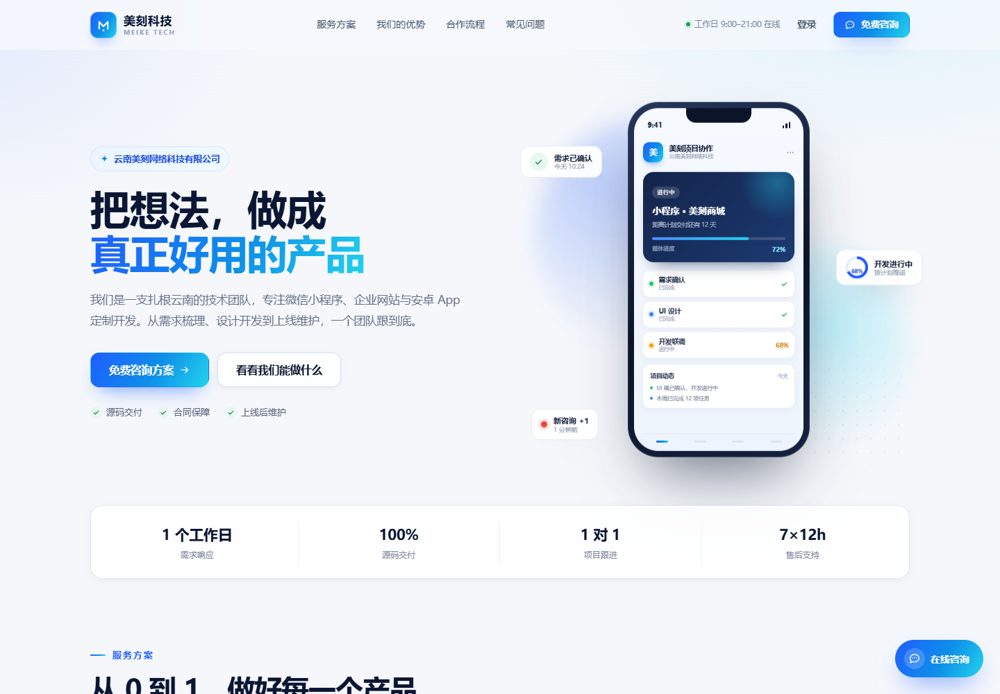
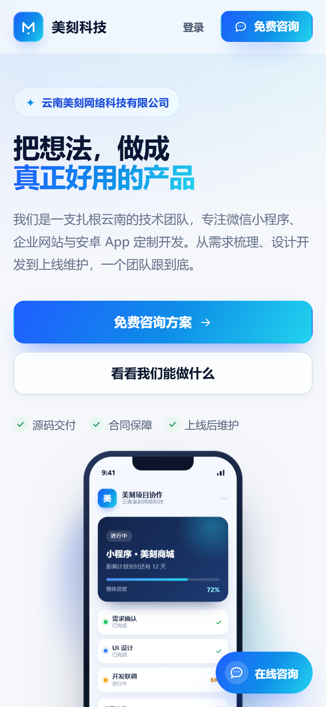
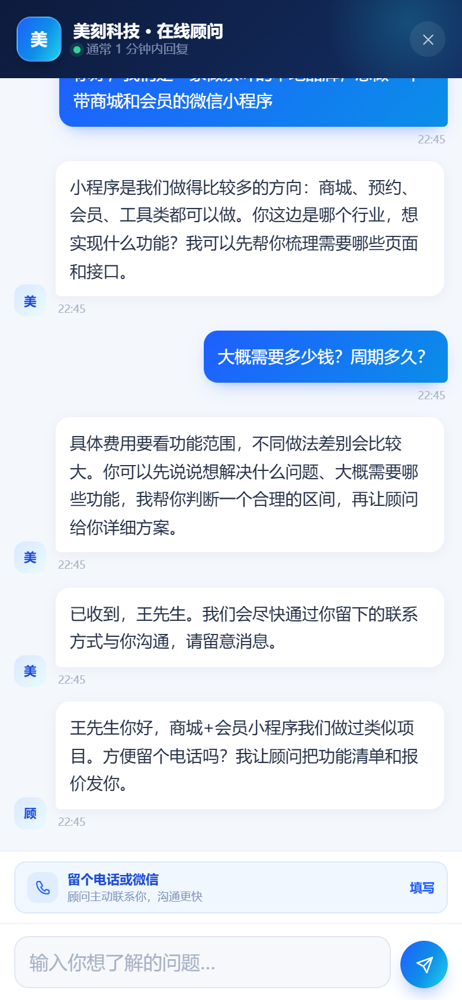
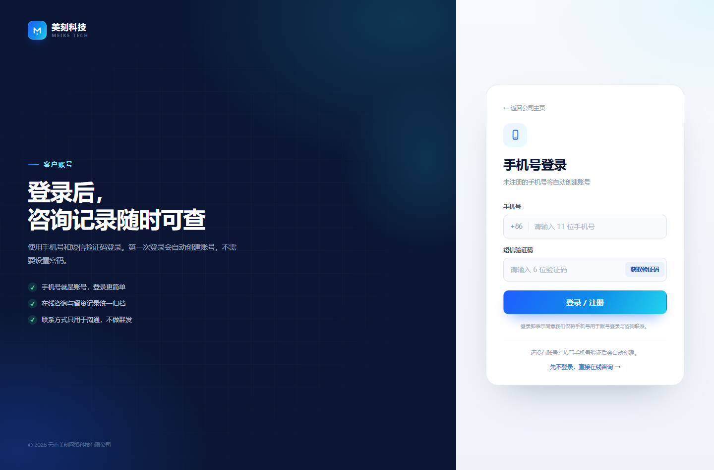
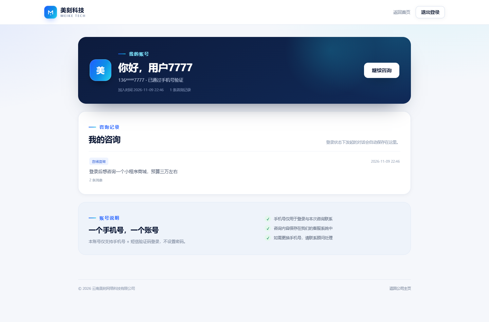
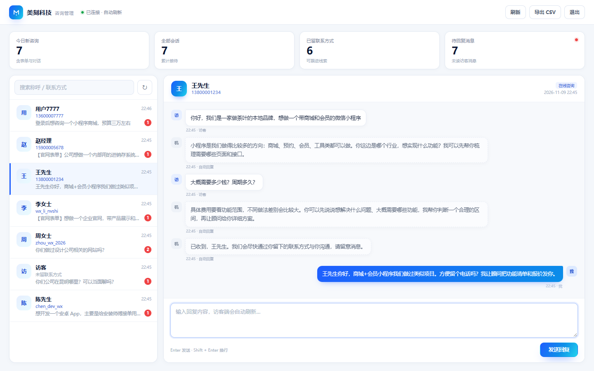

# 美刻科技 · 公司官网与在线咨询

云南美刻网络科技有限公司的官方业务介绍页，面向**微信服务号内打开的 H5** 场景。
单页展示技术服务（微信小程序 / 企业网站 / 安卓 App / 数字化系统），核心目标是让访客
**发起在线咨询、留下联系方式**，不接微信支付，不做完整的商城订单流程。

在此基础上增加了**客户手机号登录**：只支持手机号 + 短信验证码，未注册手机号自动建号，
登录后可查看自己的咨询记录。短信走腾讯云 SMS，登录验证码模板 **2744631**。

后端使用 **FastAPI**，前端为原生 HTML / CSS / JavaScript，数据落在服务器已有的 **PostgreSQL** 中
（独立新库 `meishi_app`，不使用 SQLite，也不影响同实例里的其它库），无前端构建步骤。



## 当前部署

- 线上地址：<https://meike.qianduoduo.fun/>
- 客服后台：<https://meike.qianduoduo.fun/admin>
- 服务器目录：`/myProject/meishi-app`；容器 `meike-site`（只绑定 `127.0.0.1:8700`）
- Nginx 站点：`/etc/nginx/sites-available/meike`，已用 Certbot 配置 HTTPS 与 80→443 跳转
- 数据库：现有 PG 实例中的独立库 `meishi_app`；未改动 `zuyu`、`shuyu` 等其它库和 PG 容器
- 本次部署时已清空自己库里的演示数据，后台从 0 条真实咨询开始
- 管理密码不在仓库里，见服务器 `/myProject/meishi-app/.env` 的 `ADMIN_PASSWORD`

> 服务器上原本的 `zuyu-backend` / `zuyu-frontend` / `myquant` 等容器均未删除或重建；
> 本次只新增了 `meike-site` 容器和 `meike` Nginx 站点。

## 功能

- **公司主页**：首屏品牌展示、4 项服务方案、选择理由、合作流程、常见问题、联系表单、页脚。
- **在线咨询窗口**：右下角悬浮入口，支持快捷问题、关键词自动回复、会话持久化（刷新不丢）、
  人工接管（客服回复后机器人自动静默）、未读提醒、留电话 / 微信。
- **手机号登录 / 注册**：仅支持手机号 + 短信验证码，不设密码；登录态 HttpOnly Cookie，
  默认 30 天；未注册手机号首次登录自动创建账号。
- **我的账号**：查看手机号（脱敏）、咨询记录、未读回复、退出登录。
- **留资表单**：姓名、手机号 / 微信号、需求描述，直接进入客服后台；带蜜罐字段和频率限制。
- **客服管理后台** `/admin`：密码登录、会话列表、未读消息、搜索、实时回复（8 秒轮询）、
  链路来源区分（在线咨询 / 官网表单）、导出 CSV。
- **移动端优先**：适配微信内置浏览器、iPhone 安全区、iOS 输入框缩放、全屏聊天。
- **安全基础**：CSP、X-Frame-Options、参数校验、SQL 参数化、输出转义、IP 限流、
  验证码哈希存储 / 5 次尝试上限 / 60 秒重发间隔 / 5 分钟有效、管理端登录限流。

| 手机端首页 | 在线咨询 |
| --- | --- |
|  |  |

| 手机号登录 | 我的账号 |
| --- | --- |
|  |  |



## 技术栈

- Python 3.11+ / FastAPI 0.115 / Uvicorn
- Jinja2 服务端渲染（SEO 友好，首屏无白屏）
- PostgreSQL（复用服务器已有 PG 服务，psycopg 3 + 连接池）
- 腾讯云短信 SendSms（TC3-HMAC-SHA256 签名，无额外 SDK）
- 原生 HTML / CSS / JS（无 npm、无构建）
- Docker + Nginx（HTTPS 反向代理）

## 目录结构

```text
meishi-app/
├─ app/
│  ├─ main.py              # FastAPI 入口、页面路由、安全响应头
│  ├─ config.py            # 环境变量 / .env 配置
│  ├─ content.py           # 官网文案：服务、优势、流程、FAQ
│  ├─ chatbot.py           # 关键词自动回复
│  ├─ db.py                # PostgreSQL 连接池、建表与轻量迁移
│  ├─ repository.py        # 会话 / 消息 / 线索数据访问
│  ├─ user_repo.py         # 用户、验证码、我的咨询
│  ├─ auth.py              # 用户 Cookie / 登录态读取
│  ├─ security.py          # 手机号校验、验证码哈希、签名 Token
│  ├─ sms.py               # 腾讯云 SMS TC3 客户端
│  ├─ schemas.py           # Pydantic 请求模型
│  ├─ ratelimit.py         # 进程内滑动窗口限流
│  └─ routers/
│     ├─ public.py         # 健康检查、咨询会话、留资
│     ├─ auth.py           # 发送验证码、登录、退出、当前用户
│     └─ admin.py          # 管理端登录、会话、回复、CSV 导出
├─ web/
│  ├─ templates/
│  │  ├─ index.html        # 公司主页
│  │  ├─ login.html        # 手机号登录
│  │  ├─ account.html      # 我的账号
│  │  └─ admin.html        # 客服后台
│  └─ static/
│     ├─ css/style.css
│     ├─ css/admin.css
│     ├─ js/app.js
│     ├─ js/auth.js
│     ├─ js/admin.js
│     └─ img/favicon.svg
├─ scripts/send_test_sms.py # 手工验证腾讯云短信配置
├─ tests/                  # pytest 接口测试
├─ deploy/                 # Nginx / systemd 示例
├─ Dockerfile
├─ docker-compose.yml
├─ requirements.txt
├─ .env.example
├─ run.ps1
└─ run.sh
```

## 本地运行

要求：Python 3.11+（3.12 / 3.13 均可），无需 Node.js。

### Windows

```powershell
.\run.ps1
```

### macOS / Linux

```bash
chmod +x run.sh
./run.sh
```

脚本会自动创建 `.env`、虚拟环境并安装依赖，然后启动在 **8700** 端口。

也可以手动启动：

```bash
python -m venv .venv
# Windows: .venv\Scripts\activate
source .venv/bin/activate
pip install -r requirements.txt
cp .env.example .env
# 必填：PG_PASSWORD；本地连服务器 PG 还要先开 SSH 隧道（见“数据库”一节）
python -m app.main
```

> 没有配置 `PG_PASSWORD` / `DATABASE_URL` 时，服务启动会直接报错并提示，不会静默使用本地文件库。

打开：

- 公司主页：<http://127.0.0.1:8700/>
- 手机号登录：<http://127.0.0.1:8700/login>
- 我的账号：<http://127.0.0.1:8700/account>
- 客服后台：<http://127.0.0.1:8700/admin>
- 直接打开咨询窗口：<http://127.0.0.1:8700/?chat=1>

> 默认管理密码是 `meike2026`。**部署到公网前必须修改 `.env` 中的 `ADMIN_PASSWORD`。**

### 本地测试登录（没有短信通道）

`.env` 中设置：

```dotenv
SMS_PROVIDER=auto
SMS_DEBUG=true
```

此时 `POST /api/auth/send-code` 会在响应的 `debug_code` 字段返回验证码，登录页也会直接显示；
不会真的发短信。**生产环境必须设置 `SMS_DEBUG=false`。**

## 配置

配置读取顺序：系统环境变量 > 项目根目录 `.env` > 代码默认值。修改 `.env` 后重启服务生效。

| 变量 | 默认值 | 说明 |
| --- | --- | --- |
| `APP_PORT` | `8700` | 本地启动端口（Docker 中为宿主机映射端口） |
| `APP_TIMEZONE` | `Asia/Shanghai` | 后台“今日”统计与导出时间使用的时区 |
| `PG_HOST` | `host.docker.internal` | PostgreSQL 地址；Docker 部署保持此值 |
| `PG_PORT` | `5430` | PG 宿主机映射端口（按服务器实际端口改） |
| `PG_USER` | `quant` | PG 用户（沿用已有实例账号） |
| `PG_PASSWORD` | 空 | PG 密码，必填 |
| `PG_DB` | `meishi_app` | 本项目独立数据库名，不要填其它项目库 |
| `DATABASE_URL` | 空 | 可选完整连接串，填写后覆盖上面的 PG_* |
| `PIP_INDEX_URL` | 清华镜像 | 仅构建 Docker 镜像时使用，避免 pypi.org 超时 |
| `ADMIN_PASSWORD` | `meike2026` | 管理后台密码，上线前务必修改 |
| `CHAT_AUTO_REPLY` | `true` | 是否启用关键词自动回复 |
| `MESSAGE_RATE_LIMIT` | `20` | 单 IP 每分钟聊天消息上限 |
| `USER_SESSION_SECRET` | 空 | 用户登录态签名密钥；空则从管理密码派生 |
| `USER_SESSION_DAYS` | `30` | 用户登录态有效天数 |
| `SMS_PROVIDER` | `auto` | `auto` / `tencent` / `mock` |
| `SMS_DEBUG` | `false` | 本地调试返回 `debug_code`；生产必须 false |
| `SMS_CODE_TTL_SECONDS` | `300` | 验证码有效期 |
| `SMS_TEMPLATE_PARAMS` | `auto` | 模板参数：`auto` / `code` / `code,ttl` |
| `TENCENT_SMS_SECRET_ID` | 空 | 腾讯云 API 密钥 SecretId |
| `TENCENT_SMS_SECRET_KEY` | 空 | 腾讯云 API 密钥 SecretKey |
| `TENCENT_SMS_SDK_APP_ID` | `1401204550` | 短信应用 SdkAppId |
| `TENCENT_SMS_SIGN_NAME` | `云南美刻网络科技` | 已审核短信签名 |
| `TENCENT_SMS_LOGIN_TEMPLATE_ID` | `2744631` | 登录验证码模板 ID |
| `TENCENT_SMS_REGION` | `ap-guangzhou` | 短信接口 Region |
| `TENCENT_SMS_TIMEOUT` | `5` | 短信请求超时（秒） |
| `COMPANY_NAME` | 云南美刻网络科技有限公司 | 公司全称 |
| `COMPANY_SHORT` | 美刻科技 | 品牌短名 |
| `COMPANY_EN` | MEIKE TECH | 英文标识 |
| `COMPANY_SLOGAN` | 把好想法，做成好产品 | 品牌语 |
| `COMPANY_SERVICE_AREA` | 云南 | 服务区域，显示在联系区 / 页脚 |
| `COMPANY_PHONE` | 空 | 电话；填写后显示在联系区，可点击拨打 |
| `COMPANY_WECHAT` | 空 | 微信号；填写后显示 |
| `COMPANY_EMAIL` | 空 | 邮箱；填写后显示 |
| `COMPANY_ADDRESS` | 空 | 地址；填写后显示 |
| `COMPANY_ICP` | 空 | ICP 备案号；备案后填写并链接工信部 |
| `SITE_URL` | 空 | 线上域名（用于 canonical / og:url） |

联系方式留空时，页面只展示“在线咨询 / 服务范围”，不会出现空号码。

## 数据库（PostgreSQL）

本项目**不使用 SQLite**，也不在 compose 里新建 PostgreSQL 服务。它复用服务器上已经在跑的 PG 实例，
只使用一个独立的新数据库 **`meishi_app`**；同实例里的其它库（如 `zuyu`、`shuyu` 等）不会被读取或修改。

> 当前服务器上已创建好 `meishi_app`，表结构由应用启动时自动创建。禁止执行 `dropdb`、删除 PG 容器、
> 清空其它库等操作；部署脚本/本项目的测试也做了保护：`reset_db()` 只允许在库名以 `_test` 结尾时运行。

### 连接方式

| 场景 | 配置 |
| --- | --- |
| 服务器 Docker 部署 | `PG_HOST=host.docker.internal`、`PG_PORT=5430`（compose 已配 `host-gateway`） |
| 本机直连服务器开发 | 先做 SSH 隧道，再设 `PG_HOST=127.0.0.1`、`PG_PORT=5431` |
| 单元测试 | 本机临时 PG 容器，`meishi_test` 库（见“测试”一节） |

本机 SSH 隧道示例（端口按需调整）：

```bash
ssh -i <部署私钥> -N -L 127.0.0.1:5431:127.0.0.1:5430 <服务器用户>@<服务器地址>
```

### 建库（只做一次）

如果目标 PG 里还没有 `meishi_app`，用**幂等**命令创建（存在则跳过，不删任何东西）：

```bash
PG=myquant   # 实际 PG 容器名
docker exec "$PG" psql -U quant -d postgres -tAc \
  "SELECT 1 FROM pg_database WHERE datname='meishi_app'" | grep -q 1 \
  || docker exec "$PG" createdb -U quant meishi_app
```

应用启动时会自动执行 `CREATE TABLE IF NOT EXISTS` 和 `ADD COLUMN IF NOT EXISTS`，不需要手工跑
SQL 文件；**不要**在生产库执行 `reset_db()` 或 `DROP TABLE`。

### 备份

```bash
PG=myquant   # 实际 PG 容器名
# 只备份本项目库，不影响其它库
docker exec "$PG" pg_dump -U quant -d meishi_app -Fc > meishi_app_$(date +%F).dump
```

恢复：

```bash
docker exec -i "$PG" pg_restore -U quant -d meishi_app --clean --if-exists < meishi_app_2026-11-09.dump
```

## 手机号登录与短信验证码

### 流程

1. 登录页输入 11 位手机号，点击“获取验证码”。
2. 后端校验手机号、60 秒重发间隔、同手机号每小时最多 5 次、同 IP 限流，然后生成 6 位随机码。
3. 验证码只以 HMAC 哈希写入 `sms_codes` 表；通过腾讯云 `SendSms` 发送模板 `2744631`。
4. 用户输入验证码，后端校验有效期（默认 5 分钟）、错误次数（最多 5 次）、一次性消费。
5. 校验通过后按手机号查找用户，不存在则自动创建；写入 HttpOnly Cookie（默认 30 天）。
6. 登录后访问 `/account` 查看脱敏手机号、咨询记录和未读回复；退出登录清除 Cookie。

### 腾讯云短信配置

参考 `zuyu-app` 的短信实现（同样是腾讯云 SendSms + TC3 签名）。在项目 `.env` 填写：

```dotenv
TENCENT_SMS_SECRET_ID=你的SecretId
TENCENT_SMS_SECRET_KEY=你的SecretKey
TENCENT_SMS_SDK_APP_ID=1401204550
TENCENT_SMS_SIGN_NAME=云南美刻网络科技
TENCENT_SMS_LOGIN_TEMPLATE_ID=2744631
SMS_DEBUG=false
```

注意：

- 密钥是**腾讯云云 API 密钥**（访问管理 → API 密钥管理），不是 COS 的上传账号密码。
- 已通过腾讯云只读接口核对：模板 `2744631` 名称为「美刻验证码」，内容为
  `您的动态验证码为：{1}，您正在进行密码重置操作，如非本人操作，请忽略本短信！`，
  **只有一个 `{1}` 参数**，因此生产环境可直接设置 `SMS_TEMPLATE_PARAMS=code`。
  如果介意模板里的“密码重置”措辞，可在腾讯云控制台换一个登录场景模板，只改
  `TENCENT_SMS_LOGIN_TEMPLATE_ID` 即可。
- 默认 `SMS_TEMPLATE_PARAMS=auto`：先只传验证码，如果腾讯云返回模板参数不匹配，
  会自动重试“验证码 + 有效分钟数”。也可以显式设置：
  - 模板内容只有 `{1}`（验证码）：`SMS_TEMPLATE_PARAMS=code`
  - 模板内容有 `{1}` 和 `{2}`（有效期）：`SMS_TEMPLATE_PARAMS=code,ttl`
- 真实发送前建议先手工验证模板与签名：

```powershell
.\.venv\Scripts\python.exe scripts\send_test_sms.py --to 13800001234
```

  Linux/macOS 把 `.\.venv\Scripts\python.exe` 换成 `.venv/bin/python`。

### 本地 mock

没有腾讯云密钥时：

```dotenv
SMS_DEBUG=true
```

`auto` 模式会走 mock，不发短信，验证码直接显示在登录页（仅本地）。生产环境不配置密钥时，
发送接口会返回 503“短信服务未配置”，不会假装发送成功。

### 安全说明

- 验证码 6 位、5 分钟有效、一次使用；错误 5 次即失效。
- 验证码以 HMAC-SHA256 哈希存储，不存明文。
- 发送接口同时限制手机号（60 秒、每小时 5 次）和 IP（10 次 / 10 分钟）。
- 登录接口限制 IP（20 次 / 5 分钟）。
- 登录态为签名 Token，放在 HttpOnly + SameSite=Lax Cookie；Nginx 传递
  `X-Forwarded-Proto: https` 时自动加 `Secure`。
- `SMS_DEBUG=true` 会把验证码返回给请求方，**只能本地使用**；启动日志会打印警告。

## 管理后台

1. 访问 `/admin`，输入 `ADMIN_PASSWORD` 登录。
2. 左侧是会话列表：显示称呼、联系方式、最后一条消息、未读数，支持搜索。
3. 点击会话查看完整对话；访客发来的消息会实时出现（8 秒轮询），未读自动清零。
4. 在底部输入回复，访客聊天窗口会在 3.5 秒内收到（轮询）。
5. “导出 CSV” 导出全部会话和联系方式，Excel 可直接打开（带 UTF-8 BOM）。
6. 后台登录态保存在当前浏览器标签页的 `sessionStorage`，关闭标签页即退出。

管理接口使用 `X-Admin-Token` 请求头校验，Token 由密码派生；修改密码后旧 Token 立即失效。

登录用户的咨询会写入 `conversations.user_id`，在后台仍按普通会话处理；用户侧则在
`/account` 中看到自己的记录。

## 接入微信服务号

1. **域名与 HTTPS**：微信内置浏览器要求网页可正常访问，生产环境请使用**已完成 ICP 备案的域名 + HTTPS**。
   不要用 IP、HTTP 或未备案域名。
2. **自定义菜单**：在公众号后台「自定义菜单」添加“跳转网页”，地址填
   `https://你的域名/?chat=1`（打开即弹出咨询窗口）或 `https://你的域名/`（先看主页）。
3. **手机号登录**：页面内直接使用手机号 + 短信验证码，不依赖微信网页授权；
   微信内置浏览器可以正常使用数字键盘和验证码。
4. **JS 接口安全域名**：当前页面没有接入微信 JS-SDK（不需要自定义分享、拍照、定位等能力），
   因此不强制配置。后续若要做自定义分享卡片，再在公众号后台配置「JS 接口安全域名」并接入签名接口。
5. **不需要微信支付**：本项目没有支付、下单、退款相关逻辑。
6. **手机端验证**：上线后分别在 iOS 微信、安卓微信中检查首屏、登录、咨询窗口、表单键盘和安全区。

## 部署

### 方式一：Docker Compose（推荐）

```bash
cp .env.example .env
# 编辑 .env：填写 PG_PASSWORD、修改 ADMIN_PASSWORD、填写 TENCENT_SMS_SECRET_ID / SECRET_KEY
docker compose up -d --build
```

> 本服务器只有独立版 `docker-compose`（没有 compose 插件），把命令中的 `docker compose`
> 换成 `docker-compose` 即可；本次实际部署用的就是 `docker-compose`。

- 容器内监听 `8700`，宿主机默认只映射到 `127.0.0.1:8700`，由 Nginx 对外提供 HTTPS。
- compose **不启动 PostgreSQL**：容器通过 `extra_hosts: host.docker.internal:host-gateway`
  连接宿主机上已有的 PG（`PG_PORT` 按实际发布端口，如 `5430`）。
- 不使用数据卷；所有数据都在 PG 的 `meishi_app` 库中，重建容器不会丢数据，也不会影响其它库。
- 如需直接对外暴露端口，把 `docker-compose.yml` 中的
  `"127.0.0.1:${APP_PORT:-8700}:8700"` 改为 `"${APP_PORT:-8700}:8700"`。

### 方式二：systemd + 虚拟环境

参考 `deploy/meike-site.service`，把代码放到 `/opt/meike-site`，创建 `.venv` 后：

```bash
sudo cp deploy/meike-site.service /etc/systemd/system/
sudo systemctl daemon-reload
sudo systemctl enable --now meike-site
```

### Nginx + HTTPS

参考 `deploy/nginx.conf.example`：

- 80 端口跳转 443，`/.well-known/acme-challenge/` 留给 certbot；
- 443 反向代理到 `127.0.0.1:8700`；
- 传递 `X-Forwarded-For` / `X-Forwarded-Proto`；
- 静态资源单独缓存 1 小时。

首次签发证书示例：

```bash
sudo certbot --nginx -d meike.example.com
```

### 端口说明

本项目默认端口是 **8700**，与原 zuyu 项目的 `8600` / `8080` / `8081` 均不冲突。
本地开发、Docker 宿主机映射、Nginx upstream 都使用 8700；如需修改，只改 `APP_PORT`（本地）
或 compose 端口映射，不要改动原项目配置。

## 数据与备份

- 数据库：服务器已有 PostgreSQL 实例中的独立库 **`meishi_app`**（不是 SQLite，不使用本地文件）。
- 表：
  - `users`：手机号、昵称、状态、注册 / 最近登录时间；
  - `sms_codes`：验证码哈希、有效期、尝试次数、消费时间、IP；
  - `conversations`：会话 / 联系方式 / 未读数 / 关联用户 `user_id`；
  - `messages`：访客、机器人、客服消息。
- 备份与恢复命令见“数据库（PostgreSQL）→ 备份”一节；只操作 `meishi_app`，不要动其它库。
- 本项目不提供删除会话的界面，避免误删线索；如需清理测试数据，请在测试库进行，生产库不要执行 `DROP`。
- `reset_db()` 只允许库名以 `_test` 结尾；对 `meishi_app` 调用会直接抛错，防止误清空。
- 聊天内容会原样保存，用于客服跟进。建议在隐私政策中说明用途，不要用于群发营销。

## API 摘要

公开接口（无需登录）：

| 方法 | 路径 | 说明 |
| --- | --- | --- |
| GET | `/api/health` | 健康检查 |
| POST | `/api/auth/send-code` | 发送登录验证码（本地 debug 返回 `debug_code`） |
| POST | `/api/auth/login` | 手机号 + 验证码登录 / 自动注册 |
| POST | `/api/auth/logout` | 退出登录 |
| GET | `/api/auth/me` | 当前登录用户 |
| POST | `/api/chat/sessions` | 创建 / 复用会话（`session_id` 可选） |
| GET | `/api/chat/sessions/{id}/messages?after_id=0` | 拉取消息（同时清除访客未读） |
| POST | `/api/chat/sessions/{id}/messages` | 发送访客消息，返回机器人回复 |
| GET | `/api/chat/sessions/{id}/unread` | 未读客服消息数 |
| POST | `/api/chat/sessions/{id}/contact` | 保存称呼 + 手机号 / 微信 |
| POST | `/api/leads` | 联系表单留资 |

管理接口（需要 `X-Admin-Token`）：

| 方法 | 路径 | 说明 |
| --- | --- | --- |
| POST | `/api/admin/login` | 密码登录，返回 token |
| GET | `/api/admin/me` | 校验登录态 |
| GET | `/api/admin/overview` | 今日 / 全部 / 留资 / 未读统计 |
| GET | `/api/admin/conversations?q=` | 会话列表与搜索 |
| GET | `/api/admin/conversations/{id}` | 会话详情（自动标记已读） |
| POST | `/api/admin/conversations/{id}/messages` | 客服回复 |
| POST | `/api/admin/conversations/{id}/read` | 标记已读 |
| GET | `/api/admin/export.csv` | 导出 CSV |

公开接口均有 IP 限流；被限流时返回 `429`。

## 测试

测试使用独立的本地 PG 库 `meishi_test`，**不会连接或清空生产库 `meishi_app`**。先启动一个临时
PostgreSQL 容器（只用于测试，不影响服务器上的 PG）：

```bash
docker run -d --name meishi-pg-test \
  -e POSTGRES_USER=meishi \
  -e POSTGRES_PASSWORD=meishi-test-pass \
  -e POSTGRES_DB=meishi_test \
  -p 127.0.0.1:55440:5432 \
  postgres:16
```

然后：

```bash
pip install -r requirements-dev.txt
pytest -q
```

测试默认连接 `127.0.0.1:55440 / meishi_test`；如用别的测试库，可通过
`TEST_PG_HOST` / `TEST_PG_PORT` / `TEST_PG_USER` / `TEST_PG_PASSWORD` / `TEST_PG_DB` 覆盖。
`reset_db()` 有硬保护：只允许 `*_test` 库。

覆盖：主页渲染 / 安全响应头、健康检查、完整咨询链路、机器人静默、留资、管理端鉴权、
消息校验、CSV 导出、手机号验证码登录 / 自动注册 / 退出、登录态、验证码尝试上限、
会话与用户关联、腾讯云 TC3 签名与请求体。测试使用 mock 短信，不会发真实短信。
当前共 16 项测试。

## 上线检查清单

- [ ] 修改 `ADMIN_PASSWORD`，不要使用默认密码
- [ ] 确认 `PG_DB=meishi_app`、`PG_PASSWORD` 正确，且应用能连上已有 PG（不要新建/删除 PG 容器）
- [ ] 确认没有把 `PG_DB` 填成 `zuyu` / `shuyu` 等其它项目库
- [ ] 配置 `TENCENT_SMS_SECRET_ID` / `TENCENT_SMS_SECRET_KEY`，并确认模板 2744631 可用
- [ ] 设置 `SMS_DEBUG=false`
- [ ] 用 `scripts/send_test_sms.py --to 你的手机号` 验证短信签名 / 模板
- [ ] 配置已备案域名 + HTTPS 证书
- [ ] 填写 `COMPANY_PHONE` / `COMPANY_WECHAT` / `COMPANY_EMAIL` / `COMPANY_ICP`
- [ ] 用 `pg_dump` 备份 `meishi_app`，确认不触碰其它数据库
- [ ] 用手机微信打开首页、登录、发消息、留联系方式、后台回复各走一遍
- [ ] 检查公众号菜单链接为 `https://域名/?chat=1`
- [ ] 不对外暴露 8700 / 5430 端口（只允许 Nginx 和本机访问）
- [ ] 定期查看后台未读，及时回复

## 版权

© 云南美刻网络科技有限公司。本项目为内部业务系统，未授权请勿转载或商用。
